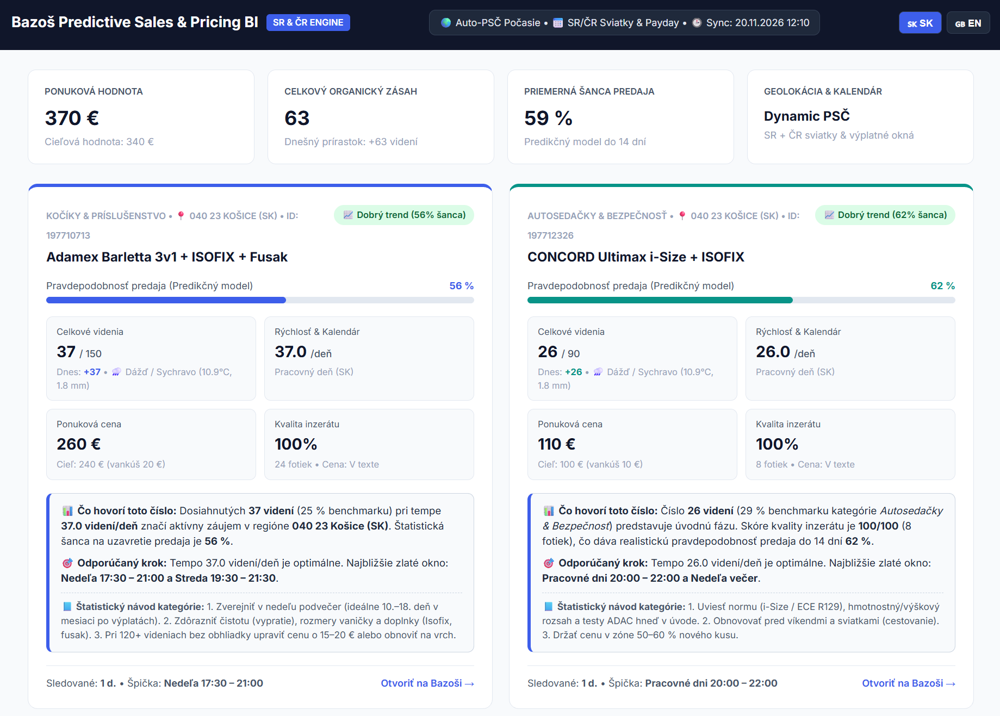
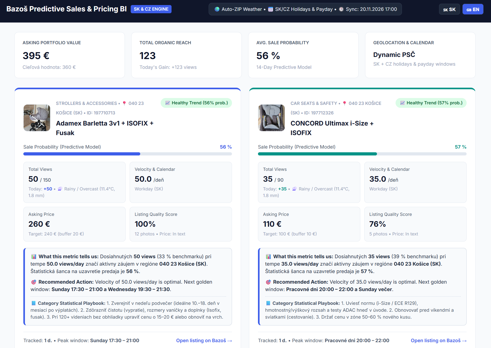

# 📊 Bazoš Predictive BI & Listing Monitor (SK & CZ)

[](https://github.com/JaroslavaG/bazos-predictive-bi)
[](https://www.python.org/)
[](https://jaroslavag.github.io/bazos-predictive-bi/)

> 🇬🇧 **English Summary below** | 🇸🇰 **Slovenský popis projektu**

🔗 **Live Dashboard (GitHub Pages):** [https://jaroslavag.github.io/bazos-predictive-bi/](https://jaroslavag.github.io/bazos-predictive-bi/)

---

## 🖼️ Ukážka živého BI Dashboardu / Dashboard Preview

### 🇸🇰 Prehľad portfólia, predikcie predaja a kontext počasia (SK)


### 🇬🇧 Interaktívne grafy vývoja a bilingválne rozhranie (EN)


---

## ⚙️ Architektúra riešenia (End-to-End CI/CD & BI Pipeline)

```mermaid
flowchart LR
    A[Bazoš.sk / .cz HTML] -->|BeautifulSoup4 Scraper| B(monitor.py)
    C[Open-Meteo API<br/>Auto-PSČ & GPS] --> B
    D[SR & ČR Kalendár<br/>Sviatky + Payday] --> B
    E[test_monitor.py<br/>8 Unit & Int. Testov] -->|GitHub Actions CI| B
    B -->|Časové rady| F[(historia_videni.csv)]
    B -->|Generovanie UI| G[index.html + i18n.js<br/>GitHub Pages]
    B -->|Detekcia zlomu| H[SMTP E-mail Alert]

🇸🇰 Slovenský popis projektuAutomatizovaný analytický a predikčný BI nástroj na sledovanie výkonnosti inzerátov na portáli Bazoš.sk / Bazoš.cz. Spája cielený web scraping, kontextové dáta (lokálne počasie podľa PSČ, štátne sviatky SR/ČR, povýplatné nákupné okná) a konzervatívny predikčný model pravdepodobnosti predaja do 14 dní v prehľadnom dvojjazyčnom dashboarde (SK / EN).✨ Hlavné funkcie🖼️ Automatické náhľady a ID-filtrované parsovanie (monitor.py):Automaticky sťahuje titulnú fotku každého inzerátu priamo z CDN Bazoša bez zaťažovania repozitára obrázkami.Počíta presný počet fotografií prísne pre konkrétnu položku podľa jej ID (filtruje a ignoruje miniatúry odporúčaných inzerátov v spodnej časti stránky).💶 Inteligentná živá detekcia ceny (extract_live_price):Rozlišuje medzi číselnou cenou v tabuľke a režimom „V texte“.Ak je na Bazoši nastavené „V texte“, skript automaticky vytiahne aktuálnu ponukovú sumu priamo z popisu inzerátu, takže zmena ceny na Bazoši sa okamžite premietne do dashboardu, vankúša zľavy aj analýzy cenovej elasticity.📈 Predikčný model pravdepodobnosti predaja (14-dňové okno):Vyhodnocuje skóre kvality inzerátu (počet fotiek, prítomnosť rozmerov/hmotnosti, dĺžku popisu), denné tempo videní (velocity), nasýtenie publika oproti benchmarku kategórie aj kalendárne/sezónne vplyvy.🌍 Auto-PSČ Geolocation & Počasie (Open-Meteo API):Z detailu inzerátu automaticky extrahuje PSČ, mesto a GPS súradnice a priraďuje aktuálne lokálne počasie (daždivé dni zvyšujú záujem o hračky a interiérové vybavenie; slnečné víkendy zas o kočíky a šport).📅 Kalendárny & Behaviorálny kontext (SR & ČR):Zohľadňuje pracovné dni, víkendy, pevné aj pohyblivé štátne sviatky SR/ČR a silné povýplatné obdobie (10. – 18. deň v mesiaci).📉 Analýza cenovej elasticity & 🔔 SMTP E-mail Alert:Pri zmene ceny vypočíta percentuálnu zmenu denného záujmu pred a po zľave; pri poklese pod minimum alebo dosiahnutí cenového zlomu odošle e-mailové odporúčanie.🌐 Bilingválne rozhranie SK / EN (i18n.js):Bezpečný klientsky prekladač textových uzlov v reálnom čase bez narušenia interaktívnych grafov Chart.js.🇬🇧 English SummaryAn end-to-end automated analytics and predictive intelligence dashboard built to monitor, evaluate, and optimize classified listings on Bazoš.sk / Bazoš.cz. The pipeline combines ID-scoped HTML scraping, real-time cover thumbnail & price extraction, local ZIP-code weather enrichment, Slovak & Czech holiday calendars, post-payday behavioral windows, and a 14-day sale probability model published via GitHub Pages with instant SK / EN language switching.✨ Key Features🖼️ Live Cover Thumbnails & ID-Scoped Parsing: Extracts the primary listing photo directly from Bazoš and counts photos strictly matching {ad_id}.jpg (ignoring Similar/Other Listings at the bottom of the page).💶 Dual-Mode Live Price Sync (extract_live_price): Reads both numeric table prices and "V texte" (In text) prices directly from the ad description, keeping metrics and price-elasticity calculations synced automatically.📈 14-Day Sale Probability Model: Calibrated by product category (kocik, autosedacka, oblecenie, sport_hracky), listing quality score, daily view velocity, and audience saturation.🌍 Auto-ZIP Weather & SK/CZ Calendar Engine: Fetches local weather via Open-Meteo API using extracted postal codes (PSČ) and factors in SK/CZ holidays, weekends, and payday windows (10th–18th of the month).🌐 Non-Destructive Bilingual UI (i18n.js): Instant client-side 🇸🇰 SK / 🇬🇧 EN toggle with localStorage persistence that preserves live Chart.js canvases.🗂️ Štruktúra repozitára / Repository StructureSúbor / FilePopis / Descriptionmonitor.pyHlavný Python engine — scraping Bazoša, živá cena a fotky, počasie, predikčný model, e-maily a generovanie index.html.inzeraty.jsonKonfigurácia sledovaných inzerátov (ID, kategória, názov, URL, východisková a cieľová cena, min. denný nárast, benchmark).historia_videni.csvAuditný CSV denník meraní (dátum, krajina, PSČ lokalita, počasie, videnia, prírastok, aktuálna cena, šanca predaja).index.htmlAutomaticky generovaný responzívny BI dashboard s kartami inzerátov, grafmi (Chart.js), manuálom kategórií a audit logom.i18n.jsKlientsky lokalizačný modul pre okamžité prepínanie jazyka (🇸🇰 SK / 🇬🇧 EN).test_monitor.pyAutomatizovaná sada unit a integračných testov spúšťaná v CI/CD pred každým meraním..github/workflows/check_ads.ymlGitHub Actions workflow na spúšťanie testov, monitoringu a publikovanie zmien na GitHub Pages.⚙️ Pridanie nového inzerátu / Adding a Tracked Listing (inzeraty.json)JSON{
  "id": "197721729",
  "kategoria": "sport_hracky",
  "nazov": "Fisher-Price Psíkov stolček Smart Stages SK/EN",
  "url": "[https://deti.bazos.sk/inzerat/197721729/fisher-price-psikov-stolcek-smart-stages-sken.php](https://deti.bazos.sk/inzerat/197721729/fisher-price-psikov-stolcek-smart-stages-sken.php)",
  "aktualna_cena": 25,
  "cielova_cena": 20,
  "min_denny_narast": 3,
  "benchmark_videni": 70
}
Dostupné kategórie / Supported Categories (kategoria):kocik — Kočíky & Príslušenstvo / Strollers & Accessories (benchmark: 150 videní)autosedacka — Autosedačky & Bezpečnosť / Car Seats & Safety (benchmark: 90 videní)oblecenie — Detské oblečenie & Obuv / Kids Clothing & Footwear (benchmark: 60 videní)sport_hracky — Hračky, Bicykle & Šport / Toys, Bikes & Sports (benchmark: 70 videní)
