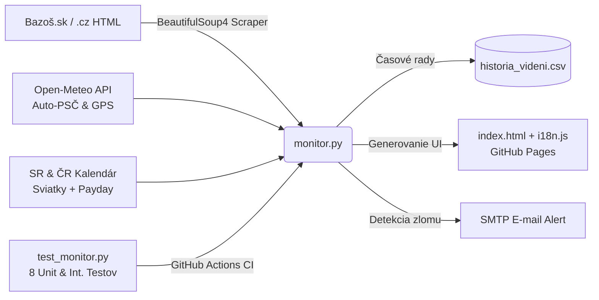

# 📊 Bazoš Predictive BI & Listing Monitor (SK & CZ)

> 🇬🇧 **English Portfolio Case Study below** | 🇸🇰 **Slovenský popis projektu**

🔗 **Živý BI Dashboard (GitHub Pages):** [https://jaroslavag.github.io/bazos-predictive-bi/](https://jaroslavag.github.io/bazos-predictive-bi/)

---

## 🖼️ Ukážka živého BI Dashboardu / Dashboard Preview

*(Tip: Nahraj 2 výrezy obrazovky z tvojho prehliadača do priečinka `assets/` pod týmito názvami a GitHub ich tu automaticky zobrazí.)*

### 🇸🇰 Prehľad portfólia, predikcie predaja a lokálneho počasia (SK)

### 🇬🇧 Interaktívne grafy vývoja a bilingválne rozhranie (EN)

---

## ⚙️ Architektúra riešenia (End-to-End CI/CD & BI Pipeline)

---

## 🇸🇰 Slovenský popis projektu

Automatizovaný **End-to-End Business Intelligence & Predictive Pricing** systém na sledovanie návštevnosti, cenovej elasticity a realistickej pravdepodobnosti predaja súkromných inzerátov na portáloch **Bazoš.sk** a **Bazoš.cz**. Projekt beží úplne bezplatne na **GitHub Actions (CI/CD)** a publikuje živý analytický dashboard s prepínačom jazykov (**SK / EN**) cez **GitHub Pages**.

### ✨ Hlavné funkcie
* **Presná geolokácia z PSČ inzerátu:** Skript automaticky vyčíta PSČ (`XXX XX`), mesto, krajinu (SR/ČR) a GPS súradnice priamo zo štruktúry inzerátu na Bazoši a priradí lokálne počasie cez **Open-Meteo API**.
* **Kalendárny & Payday kontext (SR & ČR):** Rozpoznáva víkendy, fixné aj pohyblivé štátne sviatky pre Slovensko aj Česko (vrátane algoritmického výpočtu Veľkej noci) a sleduje výplatné okná (10. – 18. deň v mesiaci).
* **Konzervatívny predikčný model predaja (%):** Vypočítava realistickú pravdepodobnosť predaja do 14 dní na základe kategórie produktu, rýchlosti videní (*View Velocity*), skóre kvality inzerátu (fotky + rozmery), počasia a kalendára.
* **Detekcia cenovej elasticity:** Pri úprave ceny v `inzeraty.json` automaticky zachytí zmenu a vyhodnotí koeficient reakcie publika (% nárast alebo pokles denných videní po zľave).
* **Bilingválny Dashboard (`SK` / `EN`):** Živá stránka (`index.html` + neinvazívny lokalizačný modul `i18n.js`) s interaktívnymi grafmi (**Chart.js**), štatistickým manuálom a auditným denníkom meraní.
* **CI/CD & Automatizované testy:** Pred každým zberom dát prebehne sada 8 unit a integračných testov (`test_monitor.py`).

### 📂 Štruktúra repozitára
* `monitor.py` – Hlavný ETL a analytický engine (scraping, geokódovanie PSČ, počasie, kalendár SR/ČR, predikčný model, cenová elasticita, generovanie HTML a SMTP e-mailov).
* `i18n.js` – Samostatný lokalizačný modul zabezpečujúci okamžité prepínanie rozhrania dashboardu medzi **SK** a **EN** bez narušenia grafov.
* `test_monitor.py` – Sada 8 automatizovaných testov (výpočet Veľkej noci, SR/ČR sviatky, Payday okno, HTML parser a PSČ, predikčný model, cenová elasticita, generovanie dashboardu).
* `inzeraty.json` – Konfiguračný zoznam sledovaných inzerátov (`id`, `kategoria`, `aktualna_cena`, `cielova_cena`, `benchmark_videni`).
* `historia_videni.csv` – Automaticky generovaná a aktualizovaná časová rada denných meraní.
* `.github/workflows/check_ads.yml` – Automatický CI/CD plánovač úloh (testy + denný zber dát o 18:00 SEČ).

---

## 🇬🇧 English Overview (Portfolio Case Study)

An automated, serverless **Predictive Pricing & Behavioral Analytics Pipeline** designed to track listing performance, view velocity, price elasticity, and 14-day conversion probability on **Bazoš.sk** and **Bazoš.cz**. Powered by **Python**, **GitHub Actions (CI/CD)**, **Open-Meteo API**, and **GitHub Pages**.

### 🚀 Key Engineering & Analytics Features
* **Automated ZIP/GPS Geolocation & Weather Enrichment:** Parses exact postal codes (`XXX XX`), city names, country codes (SK/CZ), and GPS coordinates directly from listing HTML, enriching daily metrics with localized weather data via **Open-Meteo API**.
* **Calendar & Behavioral Feature Engineering:** Incorporates Slovak & Czech public holidays (including algorithmic Easter calculation), weekend dynamics, and post-payday purchasing windows (10th–18th of each month) to prevent false-positive traffic alerts.
* **Conservative Sale Probability & Price Elasticity:** Computes a calibrated 14-day sale probability score based on category benchmarks, view velocity, and listing quality (photo count & dimension metadata), while measuring audience reaction lift (%) after price adjustments.
* **Bilingual Executive BI Dashboard (`SK` / `EN`):** Self-updating static web dashboard (`index.html` + DOM-safe `i18n.js` switcher) featuring interactive **Chart.js** visualizations, category playbooks, and a full measurement audit log.
* **Automated CI/CD Testing Pipeline:** Runs an 8-test `unittest` suite (`test_monitor.py`) prior to every scheduled data ingestion cycle.